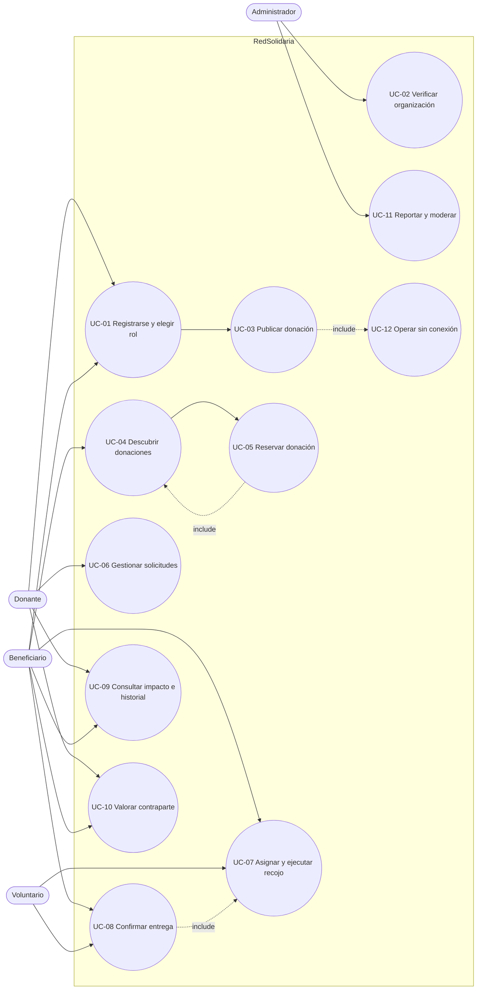

# 04 · Casos de uso

**Proyecto:** RedSolidaria · **Versión:** 1.0 · **Fecha:** 21/10/2026

---

## 1. Diagrama de actores

## 2. Catálogo de casos de uso

| ID | Caso de uso | Actores | RF asociados | Prioridad | Detalle |
|---|---|---|---|---|---|
| UC-01 | Registrarse y seleccionar rol | Donante, Beneficiario, Voluntario | RF-01, RF-02, RF-03 | Must | ✅ Especificado |
| UC-02 | Verificar organización beneficiaria | Administrador | RF-04 | Should | Resumen |
| UC-03 | Publicar donación | Donante | RF-06, RF-07, RF-08, RF-13 | Must | ✅ Especificado |
| UC-04 | Descubrir donaciones (lista y mapa) | Beneficiario, Voluntario | RF-11, RF-12, RF-14 | Must | Resumen |
| UC-05 | Reservar donación | Beneficiario | RF-15, RF-18 | Must | ✅ Especificado |
| UC-06 | Gestionar solicitudes (aceptar/rechazar/cancelar) | Donante, Beneficiario | RF-16, RF-17, RF-18 | Must | Resumen |
| UC-07 | Asignar y ejecutar recojo | Beneficiario, Voluntario, Administrador | RF-19, RF-21 | Must | ✅ Especificado |
| UC-08 | Confirmar entrega con QR/PIN | Voluntario, Beneficiario | RF-20 | Must | ✅ Especificado |
| UC-09 | Consultar impacto e historial | Todos | RF-24, RF-25, RF-26 | Must | Resumen |
| UC-10 | Valorar contraparte | Donante, Beneficiario | RF-27 | Should | Resumen |
| UC-11 | Reportar y moderar contenido | Todos, Administrador | RF-28, RF-29, RF-30 | Must | ✅ Especificado |
| UC-12 | Operar sin conexión y sincronizar | Todos | RF-31, RF-32 | Should | Resumen |

---

## 3. Especificaciones detalladas

### UC-01 · Registrarse y seleccionar rol

| Campo | Detalle |
|---|---|
| **Actores** | Donante, Beneficiario, Voluntario |
| **Objetivo** | Crear una cuenta, definir el rol y quedar habilitado para operar en la red |
| **Precondiciones** | La app está instalada; el usuario no tiene sesión activa |
| **Postcondiciones** | Usuario autenticado con rol asignado; sesión persistida; organización registrada si aplica |
| **Disparador** | El usuario abre la app por primera vez o toca "Crear cuenta" |
| **Frecuencia** | Una vez por usuario |

**Flujo principal**

1. El usuario abre la app y ve la pantalla de bienvenida con el propósito del proyecto.
2. Toca "Crear cuenta".
3. Ingresa nombre, correo, teléfono y contraseña (o elige "Continuar con Google").
4. El sistema valida formato de correo, longitud y fortaleza de contraseña.
5. El sistema crea la cuenta y envía un correo de verificación.
6. La app muestra la pantalla de selección de rol.
7. El usuario elige *Donante*, *Beneficiario* o *Voluntario*.
8. Si elige Donante o Beneficiario, ingresa nombre, tipo y dirección de la organización.
9. El sistema acepta el consentimiento de tratamiento de datos (Ley N.° 29733).
10. La app guarda el rol y redirige al inicio correspondiente.

**Flujos alternativos**

- **4a. Correo ya registrado:** el sistema muestra "Este correo ya tiene una cuenta" con acceso directo a iniciar sesión.
- **7a. Voluntario:** no se solicitan datos de organización; se pide zona de disponibilidad y medio de transporte.
- **9a. Consentimiento rechazado:** la app explica que sin consentimiento no puede tratar la ubicación y ofrece continuar con funcionalidad limitada o cancelar.

**Excepciones**

- **E1.** Fallo de red durante el registro: se muestra el error y se conservan los datos ingresados para reintentar (RNF-12).
- **E2.** El correo de verificación no llega: opción "Reenviar correo" con límite de 3 intentos.

**Requerimientos:** RF-01, RF-02, RF-03 · **RNF:** RNF-01, RNF-04, RNF-11

---

### UC-03 · Publicar donación

| Campo | Detalle |
|---|---|
| **Actores** | Donante |
| **Objetivo** | Registrar un excedente disponible para que los beneficiarios puedan reservarlo |
| **Precondiciones** | Sesión iniciada con rol Donante; permisos de ubicación y cámara (opcionales) |
| **Postcondiciones** | Publicación creada en estado `publicada`, visible en listado y mapa; visible en el historial del donante |
| **Disparador** | El donante toca el botón flotante "Publicar donación" |
| **Frecuencia** | Varias veces por semana por donante |

**Flujo principal**

1. El donante toca "Publicar donación".
2. La app muestra el formulario con los campos: título, categoría, descripción, cantidad y unidad.
3. El donante selecciona la fecha y hora de caducidad.
4. El donante adjunta de una a tres fotos (cámara o galería).
5. El donante confirma el punto de recojo en el mapa; la app completa la dirección.
6. El donante define la ventana horaria de recojo.
7. La app valida: campos obligatorios, caducidad futura, ventana de recojo ≤ caducidad, imágenes dentro del límite.
8. El donante toca "Publicar".
9. El sistema sube las imágenes, crea el registro y devuelve la publicación con su identificador.
10. La app muestra confirmación y la publicación aparece en el "Mis donaciones".

**Flujos alternativos**

- **5a. Ubicación no disponible:** el donante busca la dirección manualmente o ajusta el marcador en el mapa.
- **7a. Sin conexión:** la publicación se guarda en la cola local y se muestra como "pendiente de sincronización" (RF-32).
- **8a. El donante guarda como borrador:** la publicación no se muestra al público hasta completarse.

**Excepciones**

- **E1.** Caducidad anterior a la fecha actual: se bloquea el envío con el mensaje "La caducidad debe ser posterior a la fecha actual" (RN-03).
- **E2.** Ventana de recojo posterior a la caducidad: se sugiere ajustar automáticamente.
- **E3.** Carga de imagen fallida: se permite continuar con las imágenes restantes o reintentar.

**Requerimientos:** RF-06, RF-07, RF-08, RF-13 · **RNF:** RNF-01, RNF-02, RNF-12, RNF-13

---

### UC-05 · Reservar donación

| Campo | Detalle |
|---|---|
| **Actores** | Beneficiario |
| **Objetivo** | Obtener el compromiso formal de una donación disponible |
| **Precondiciones** | Sesión iniciada con rol Beneficiario; organización aprobada (RF-04); donación en estado `publicada` y vigente |
| **Postcondiciones** | Reserva creada en estado `pendiente`; donación bloqueada para otros beneficiarios; donante notificado |
| **Disparador** | El beneficiario toca "Reservar" en el detalle de una donación |
| **Frecuencia** | Diaria durante la operación |

**Flujo principal**

1. El beneficiario explora el listado o el mapa de donaciones (UC-04).
2. Selecciona una donación y ve el detalle con fotos, cantidad, distancia y vigencia.
3. Toca "Reservar".
4. Indica cantidad requerida (≤ disponible), número de beneficiarios y hora estimada de recojo.
5. La app muestra el resumen y solicita confirmación.
6. El sistema verifica que la donación siga `publicada` y vigente, y que el usuario esté verificado.
7. El sistema crea la reserva en estado `pendiente`, cambia la donación a `reservada` y genera el código QR/PIN de 6 dígitos.
8. El sistema notifica al donante (RF-21).
9. La app muestra "Solicitud enviada" con el estado y el acceso al seguimiento.

**Flujos alternativos**

- **6a. La donación fue reservada por otro usuario:** se informa "Esta donación ya no está disponible" y se sugiere volver al listado (RN-04).
- **6b. Organización en estado pendiente:** se informa "Tu organización está en revisión" y se bloquea la acción (RN-02).
- **4a. Cantidad solicitada mayor a la disponible:** se limita el campo y se sugiere el máximo.

**Excepciones**

- **E1.** Fallo de conexión al confirmar: la reserva se encola y se reintenta; si al sincronizar la donación ya no está disponible, se informa el conflicto y se descarta la operación (RF-32).
- **E2.** Caducidad alcanzada entre la apertura del detalle y la confirmación: se rechaza con el motivo correspondiente.

**Requerimientos:** RF-15, RF-18 · **RNF:** RNF-01, RNF-02, RNF-04

---

### UC-07 · Asignar y ejecutar recojo

| Campo | Detalle |
|---|---|
| **Actores** | Beneficiario (asigna), Voluntario (ejecuta), Administrador (reasigna) |
| **Objetivo** | Trasladar la donación desde el donante hasta la organización beneficiaria |
| **Precondiciones** | Reserva en estado `aceptada`; donación en estado `reservada` |
| **Postcondiciones** | Donación en estado `en_recojo`; voluntario con tarea activa; ambas partes notificadas |
| **Disparador** | El beneficiario toca "Asignar voluntario" en la reserva aceptada |
| **Frecuencia** | Una vez por donación |

**Flujo principal**

1. El beneficiario abre la reserva aceptada y toca "Asignar voluntario".
2. La app muestra voluntarios disponibles en un radio configurable, ordenados por distancia.
3. El beneficiario selecciona un voluntario y confirma la asignación.
4. El sistema crea la tarea de recojo con dirección del donante, dirección de destino, ventana horaria y datos de contacto internos.
5. El sistema notifica al voluntario (RF-21).
6. El voluntario acepta la asignación.
7. El voluntario toca "Iniciar recojo"; la donación pasa a `en_recojo` y se registra la marca de tiempo.
8. El voluntario llega al punto, recoge la donación y toca "Confirmar recojo".
9. El voluntario se traslada al beneficiario y entrega los alimentos.
10. Se ejecuta UC-08 para confirmar la entrega.

**Flujos alternativos**

- **6a. El voluntario declina:** la tarea vuelve a estar disponible y se notifica al beneficiario para reasignar.
- **3a. No hay voluntarios disponibles:** el beneficiario puede asumir el recojo o solicitar apoyo al administrador.
- **7a. El donante no está en el punto:** el voluntario registra la incidencia; la operación queda en revisión del administrador.

**Excepciones**

- **E1.** El voluntario pierde la conexión durante el recojo: las acciones se encolan y se sincronizan al reconectar, conservando el orden (RF-32).
- **E2.** Cancelación del donante con recojo en curso: se notifica a voluntario y beneficiario; la donación pasa a `cancelada` con motivo.

**Requerimientos:** RF-19, RF-21 · **RNF:** RNF-02, RNF-04, RNF-12

---

### UC-08 · Confirmar entrega con QR/PIN

| Campo | Detalle |
|---|---|
| **Actores** | Beneficiario (muestra el código), Voluntario o Donante (valida) |
| **Objetivo** | Dejar constancia verificable de que la donación llegó a su destino |
| **Precondiciones** | Donación en estado `en_recojo`; código QR/PIN generado y vigente |
| **Postcondiciones** | Donación en estado `entregada` → `cerrada`; métricas de impacto actualizadas; partes habilitadas para valorar |
| **Disparador** | El voluntario toca "Confirmar entrega" |
| **Frecuencia** | Una vez por donación |

**Flujo principal**

1. El voluntario toca "Confirmar entrega".
2. La app abre el escáner de QR con la opción alternativa de ingresar el PIN de 6 dígitos.
3. El beneficiario muestra el código desde su pantalla de reserva.
4. El voluntario escanea el QR (o digita el PIN).
5. El sistema valida el código contra la reserva y su vigencia.
6. El voluntario adjunta una foto de evidencia (opcional).
7. El sistema cambia el estado a `entregada`, registra fecha, autor y ubicación, y cierra la operación.
8. El sistema actualiza las métricas de impacto de ambas partes (RF-24) y registra la auditoría (RNF-14).
9. La app muestra el resumen de la entrega y habilita la valoración (UC-10).

**Flujos alternativos**

- **5a. Código incorrecto:** se muestran los intentos restantes; tras 3 fallos se bloquea por 10 minutos y se notifica al administrador.
- **5b. Código expirado:** el beneficiario puede regenerarlo desde su pantalla; solo el beneficiario y el administrador pueden hacerlo.
- **4a. Cámara no disponible:** se usa el ingreso manual del PIN.

**Excepciones**

- **E1.** Sin conexión: la confirmación se encola con el código y la marca de tiempo; al sincronizar se valida y, si el código ya expiró, queda en revisión del administrador.
- **E2.** El beneficiario no se presenta: el voluntario registra la incidencia; la donación pasa a `en_revision` y el administrador resuelve.

**Requerimientos:** RF-20 · **RNF:** RNF-04, RNF-05, RNF-14

---

### UC-11 · Reportar y moderar contenido

| Campo | Detalle |
|---|---|
| **Actores** | Cualquier usuario (reporta), Administrador (modera) |
| **Objetivo** | Retirar contenido inapropiado o falsos avisos y suspender cuentas reincidentes |
| **Precondiciones** | Sesión iniciada |
| **Postcondiciones** | Reporte registrado y resuelto; publicación oculta o cuenta suspendida; acción auditada |
| **Disparador** | El usuario toca "Reportar" en una publicación, comentario o perfil |
| **Frecuencia** | Ocasional |

**Flujo principal**

1. El usuario toca "Reportar" sobre el contenido.
2. La app muestra los motivos: alimento en mal estado, información falsa, contenido ofensivo, suplantación de identidad, otro.
3. El usuario selecciona el motivo y agrega un comentario opcional.
4. El sistema registra el reporte y confirma al usuario.
5. El administrador abre la bandeja de reportes ordenada por antigüedad y acumulación.
6. Revisa la evidencia y decide: desestimar, ocultar la publicación o suspender la cuenta.
7. El sistema aplica la decisión y registra la acción en la bitácora con autor y fecha.
8. El sistema notifica al usuario afectado con el motivo de la decisión.

**Flujos alternativos**

- **4a. Reporte duplicado:** el sistema indica que ya existe un reporte del mismo usuario para ese objeto (RF-29).
- **6a. Tercer reporte confirmado sobre la misma publicación:** se oculta automáticamente y queda en revisión (RN-08).

**Excepciones**

- **E1.** El administrador necesita más información: puede solicitar evidencia adicional y dejar el reporte en estado `en_revision`.

**Requerimientos:** RF-28, RF-29, RF-30 · **RNF:** RNF-04, RNF-14

---

## 4. Casos de uso resumidos

| UC | Flujo esencial | Resultado |
|---|---|---|
| **UC-02** | El administrador revisa datos de la organización → aprueba o rechaza con motivo → se notifica | Organización habilitada para reservar |
| **UC-04** | El beneficiario abre el listado → aplica filtros o abre el mapa → ve distancia y vigencia → abre el detalle | Donación seleccionada para reservar |
| **UC-06** | El donante revisa solicitudes → acepta o rechaza → la donación cambia de estado → se notifica | Reserva confirmada o liberada |
| **UC-09** | El usuario abre "Impacto" → ve kg, porciones, CO₂ y donaciones → filtra por periodo → exporta | Constancia de aporte |
| **UC-10** | Tras el cierre, el usuario califica de 1 a 5 y comenta → el promedio se actualiza en el perfil | Reputación visible |
| **UC-12** | Sin red, el usuario consulta datos en caché y registra acciones → al reconectar se sincroniza en orden | Operación continua sin pérdida de datos |

## 5. Control de cambios

| Versión | Fecha | Cambio |
|---|---|---|
| 0.1 | 21/10/2026 | Catálogo inicial de casos de uso |
| 0.2 | 21/10/2026 | Especificación detallada de UC-01, UC-03, UC-05, UC-07 y UC-08 |
| 1.0 | 21/10/2026 | Incorporación de UC-11 y UC-12; línea base aprobada |
