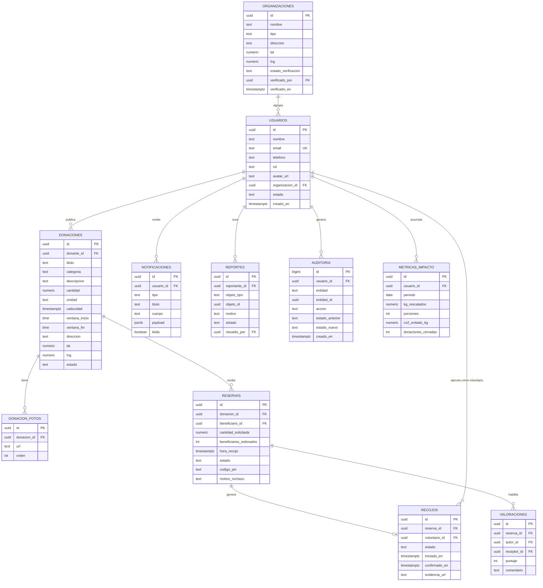
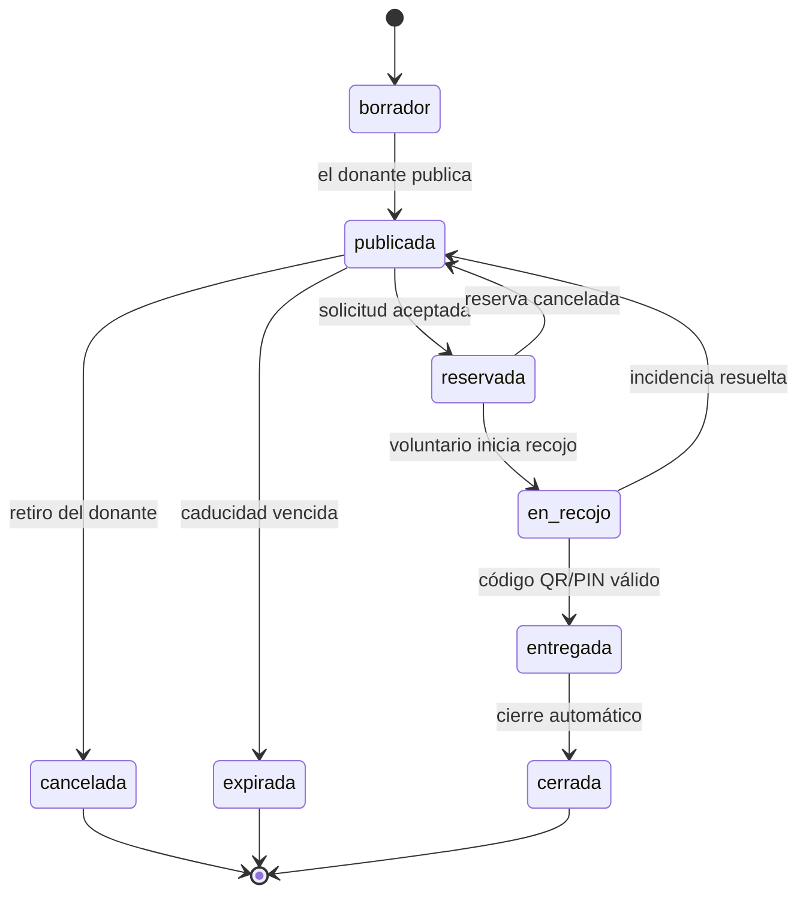

# 06 · Modelo de datos

**Proyecto:** RedSolidaria · **Versión:** 1.0 · **Fecha:** 21/10/2026
**Motor:** PostgreSQL 15 (Supabase) · **Acceso:** API REST/Realtime con RLS

---

## 1. Diagrama entidad-relación



---

## 2. Diccionario de entidades

### 2.1 `organizaciones`

| Campo | Tipo | Restricciones | Descripción |
|---|---|---|---|
| `id` | uuid | PK, `gen_random_uuid()` | Identificador |
| `nombre` | text | NOT NULL, 3–120 caracteres | Nombre de la organización |
| `tipo` | text | CHECK en (`restaurante`, `panaderia`, `mercado`, `supermercado`, `comedor`, `olla_comun`, `albergue`, `ong`, `particular`) | Naturaleza de la organización |
| `direccion` | text | NOT NULL | Dirección declarada |
| `lat` / `lng` | numeric(10,7) | NOT NULL | Coordenadas del punto |
| `estado_verificacion` | text | CHECK en (`pendiente`, `aprobada`, `rechazada`, `suspendida`), default `pendiente` | Estado de verificación |
| `verificado_por` | uuid | FK → `usuarios.id` | Administrador responsable |
| `verificado_en` | timestamptz | — | Fecha de la decisión |
| `creado_en` | timestamptz | default `now()` | Auditoría básica |

### 2.2 `usuarios`

| Campo | Tipo | Restricciones | Descripción |
|---|---|---|---|
| `id` | uuid | PK, igual a `auth.users.id` | Identificador de Supabase Auth |
| `nombre` | text | NOT NULL | Nombre completo o razón social |
| `email` | text | UNIQUE, NOT NULL | Correo de acceso |
| `telefono` | text | 9 dígitos | Contacto interno (no público) |
| `rol` | text | CHECK en (`donante`, `beneficiario`, `voluntario`, `administrador`) | Rol activo |
| `avatar_url` | text | — | Foto de perfil |
| `organizacion_id` | uuid | FK → `organizaciones.id`, nullable para voluntarios | Organización a la que pertenece |
| `zona` | text | nullable | Zona de disponibilidad (voluntarios) |
| `transporte` | text | nullable | Medio de transporte (voluntarios) |
| `estado` | text | CHECK en (`activo`, `suspendido`, `eliminado`) | Estado de la cuenta |
| `consentimiento_en` | timestamptz | NOT NULL | Fecha del consentimiento (Ley 29733) |
| `creado_en` | timestamptz | default `now()` | Alta del usuario |

### 2.3 `donaciones`

| Campo | Tipo | Restricciones | Descripción |
|---|---|---|---|
| `id` | uuid | PK | Identificador |
| `donante_id` | uuid | FK → `usuarios.id`, NOT NULL | Quien publica |
| `titulo` | text | NOT NULL, 5–100 caracteres | Resumen del alimento |
| `categoria` | text | CHECK en (`panaderia`, `frutas_verduras`, `lacteos`, `preparados`, `abarrotes`, `otros`) | Categoría para filtros |
| `descripcion` | text | hasta 500 caracteres | Detalle y condiciones |
| `cantidad` | numeric(10,2) | > 0 | Cantidad ofrecida |
| `unidad` | text | CHECK en (`kg`, `unidades`, `porciones`, `litros`) | Unidad de medida |
| `caducidad` | timestamptz | NOT NULL, > `now()` al crear | Límite de consumo |
| `ventana_inicio` | timestamptz | NOT NULL | Inicio de disponibilidad para recojo |
| `ventana_fin` | timestamptz | NOT NULL, ≤ `caducidad` | Fin de disponibilidad |
| `direccion` | text | NOT NULL | Dirección del punto de recojo |
| `lat` / `lng` | numeric(10,7) | NOT NULL | Coordenadas |
| `estado` | text | CHECK en (`borrador`, `publicada`, `reservada`, `en_recojo`, `entregada`, `cerrada`, `cancelada`, `expirada`) | Estado actual |
| `creado_en` / `actualizado_en` | timestamptz | default `now()` | Trazabilidad temporal |

### 2.4 `donacion_fotos`

| Campo | Tipo | Restricciones | Descripción |
|---|---|---|---|
| `id` | uuid | PK | Identificador |
| `donacion_id` | uuid | FK → `donaciones.id` ON DELETE CASCADE | Donación asociada |
| `url` | text | NOT NULL | Ruta en Storage |
| `orden` | int | 1–3, UNIQUE(`donacion_id`,`orden`) | Orden de visualización |

### 2.5 `reservas`

| Campo | Tipo | Restricciones | Descripción |
|---|---|---|---|
| `id` | uuid | PK | Identificador |
| `donacion_id` | uuid | FK → `donaciones.id` | Donación solicitada |
| `beneficiario_id` | uuid | FK → `usuarios.id` | Organización solicitante |
| `cantidad_solicitada` | numeric(10,2) | > 0 y ≤ `donaciones.cantidad` | Cantidad requerida |
| `beneficiarios_estimados` | int | > 0 | Personas atendidas |
| `hora_recojo` | timestamptz | dentro de la ventana | Recojo previsto |
| `estado` | text | CHECK en (`pendiente`, `aceptada`, `rechazada`, `cancelada`, `completada`) | Estado de la solicitud |
| `codigo_pin` | text | 6 dígitos, único por reserva | Código de confirmación |
| `motivo_rechazo` | text | nullable | Justificación |
| `creado_en` | timestamptz | default `now()` | Alta |

**Índice único parcial:** solo una reserva activa por donación.

```sql
CREATE UNIQUE INDEX ux_reserva_activa
  ON reservas (donacion_id)
  WHERE estado IN ('pendiente', 'aceptada');
```

### 2.6 `recojos`

| Campo | Tipo | Restricciones | Descripción |
|---|---|---|---|
| `id` | uuid | PK | Identificador |
| `reserva_id` | uuid | FK → `reservas.id`, UNIQUE | Una tarea por reserva |
| `voluntario_id` | uuid | FK → `usuarios.id` | Voluntario asignado |
| `estado` | text | CHECK en (`asignado`, `aceptado`, `en_camino`, `recogido`, `entregado`, `declinado`, `cancelado`) | Avance del traslado |
| `iniciado_en` | timestamptz | nullable | Marca de inicio |
| `confirmado_en` | timestamptz | nullable | Marca de entrega |
| `evidencia_url` | text | nullable | Foto de entrega |

### 2.7 `notificaciones`

| Campo | Tipo | Restricciones | Descripción |
|---|---|---|---|
| `id` | uuid | PK | Identificador |
| `usuario_id` | uuid | FK → `usuarios.id` | Destinatario |
| `tipo` | text | CHECK en (`solicitud`, `respuesta`, `asignacion`, `recordatorio`, `entrega`, `moderacion`) | Categoría |
| `titulo` / `cuerpo` | text | NOT NULL | Contenido visible |
| `payload` | jsonb | — | Datos para navegar a la pantalla destino |
| `leida` | boolean | default `false` | Estado de lectura |
| `creado_en` | timestamptz | default `now()` | Alta |

### 2.8 `valoraciones`

| Campo | Tipo | Restricciones | Descripción |
|---|---|---|---|
| `id` | uuid | PK | Identificador |
| `reserva_id` | uuid | FK → `reservas.id` | Operación calificada |
| `autor_id` / `receptor_id` | uuid | FK → `usuarios.id` | Partes |
| `puntaje` | int | CHECK 1–5 | Calificación |
| `comentario` | text | hasta 280 caracteres | Opinión opcional |
| `creado_en` | timestamptz | default `now()` | Alta |

**Restricción:** UNIQUE(`reserva_id`, `autor_id`).

### 2.9 `reportes`

| Campo | Tipo | Restricciones | Descripción |
|---|---|---|---|
| `id` | uuid | PK | Identificador |
| `reportante_id` | uuid | FK → `usuarios.id` | Quien reporta |
| `objeto_tipo` | text | CHECK en (`donacion`, `usuario`, `valoracion`) | Tipo de objeto |
| `objeto_id` | uuid | NOT NULL | Objeto reportado |
| `motivo` | text | CHECK en (`alimento_no_apto`, `informacion_falsa`, `contenido_ofensivo`, `suplantacion`, `otro`) | Categoría |
| `comentario` | text | nullable | Detalle |
| `estado` | text | CHECK en (`abierto`, `en_revision`, `resuelto`, `desestimado`) | Estado |
| `resuelto_por` | uuid | FK → `usuarios.id` | Administrador |
| `creado_en` | timestamptz | default `now()` | Alta |

### 2.10 `auditoria`

| Campo | Tipo | Restricciones | Descripción |
|---|---|---|---|
| `id` | bigserial | PK | Consecutivo |
| `usuario_id` | uuid | FK → `usuarios.id` | Autor de la acción |
| `entidad` | text | NOT NULL | Tabla afectada |
| `entidad_id` | uuid | NOT NULL | Registro afectado |
| `accion` | text | NOT NULL | `crear`, `actualizar`, `eliminar`, `transicion` |
| `estado_anterior` / `estado_nuevo` | text | nullable | Valores del cambio |
| `creado_en` | timestamptz | default `now()` | Momento |

> Tabla de solo inserción: sin políticas de `UPDATE` ni `DELETE` para ningún rol (RNF-14).

### 2.11 `metricas_impacto`

| Campo | Tipo | Restricciones | Descripción |
|---|---|---|---|
| `id` | uuid | PK | Identificador |
| `usuario_id` | uuid | FK → `usuarios.id` | Dueño de la métrica |
| `periodo` | date | primer día del mes | Periodo agregado |
| `kg_rescatados` | numeric(10,2) | ≥ 0 | Kilogramos entregados |
| `porciones` | int | ≥ 0 | Porciones habilitadas |
| `co2_evitado_kg` | numeric(10,2) | ≥ 0 | Emisiones evitadas |
| `donaciones_cerradas` | int | ≥ 0 | Operaciones completadas |

**Fórmulas de cálculo** (constantes configurables, documentadas como estimaciones):

```text
porciones        = kg_rescatados × 2,5        (1 porción ≈ 400 g)
co2_evitado_kg   = kg_rescatados × 2,5        (2,5 kg CO₂e por kg de alimento rescatado)
```

> Estas constantes deben declararse explícitamente en la interfaz como **estimaciones** y citarse en la presentación final.

---

## 3. Máquina de estados de la donación



| Transición | Quién puede ejecutarla | Efecto lateral |
|---|---|---|
| `borrador → publicada` | Donante | Notifica a beneficiarios con filtros guardados |
| `publicada → reservada` | Donante (al aceptar) | Genera PIN, bloquea publicación |
| `reservada → en_recojo` | Voluntario asignado | Inicia cronómetro de traslado |
| `en_recojo → entregada` | Voluntario / Donante | Actualiza métricas y auditoría |
| `entregada → cerrada` | Sistema (job) | Habilita valoraciones |
| `reservada → publicada` | Donante o Beneficiario | Libera la publicación |
| `publicada → expirada` | Sistema (job horario) | Oculta del listado |

---

## 4. Políticas de seguridad (RLS)

| Tabla | Política | Regla |
|---|---|---|
| `usuarios` | Lectura | El usuario solo lee su propio registro y los perfiles públicos mínimos de sus contrapartes |
| `usuarios` | Escritura | Solo el propio usuario actualiza sus datos; el administrador puede cambiar `estado` |
| `organizaciones` | Lectura | Público para usuarios autenticados (sin datos de contacto) |
| `organizaciones` | Escritura | Solo el administrador actualiza `estado_verificacion` |
| `donaciones` | Lectura | Autenticados: solo `publicada`, `reservada` y `en_recojo`; el dueño ve todas las suyas |
| `donaciones` | Escritura | Solo el donante dueño, y solo en `borrador` o `publicada` |
| `reservas` | Lectura | Solo las partes involucradas y el administrador |
| `reservas` | Escritura | El beneficiario crea; donante y beneficiario actualizan estado según la máquina |
| `recojos` | Escritura | El voluntario asignado actualiza el avance |
| `notificaciones` | Lectura/Escritura | Solo el destinatario |
| `valoraciones` | Escritura | Autor autenticado con reserva `completada` y sin valoración previa |
| `reportes` | Lectura | El reportante ve los suyos; el administrador ve todos |
| `auditoria` | Lectura | Solo el administrador; sin escritura desde el cliente |
| `metricas_impacto` | Lectura | El usuario ve las suyas y los agregados de la red (anonimizados) |

---

## 5. Índices y rendimiento

| Índice | Tabla | Motivo |
|---|---|---|
| `ix_donaciones_estado_caducidad` | `donaciones (estado, caducidad)` | Filtro base del listado (RNF-02) |
| `ix_donaciones_categoria` | `donaciones (categoria)` | Filtro por categoría |
| `ix_donaciones_geo` | `donaciones (lat, lng)` | Ordenamiento por cercanía |
| `ux_reserva_activa` | `reservas (donacion_id) WHERE estado IN (...)` | Regla RN-04 |
| `ix_reservas_beneficiario` | `reservas (beneficiario_id, estado)` | Bandeja del beneficiario |
| `ix_notificaciones_usuario` | `notificaciones (usuario_id, leida)` | Bandeja de notificaciones |
| `ix_auditoria_entidad` | `auditoria (entidad, entidad_id, creado_en)` | Consulta de trazabilidad |

Para el cálculo de cercanía en el piloto se usa la fórmula de Haversine en la consulta; si el volumen crece, se migra a PostGIS con `geography(Point, 4326)`.

---

## 6. Estrategia de datos de demostración (seed)

| Dato | Cantidad | Uso |
|---|---|---|
| Organizaciones beneficiarias | 3 (1 pendiente, 2 aprobadas) | Probar verificación y reservas |
| Donantes | 3 (panadería, restaurante, mercado) | Publicaciones variadas |
| Voluntarios | 2 | Asignación y recojo |
| Donaciones | 8 (2 expiradas, 1 reservada, 5 disponibles) | Probar filtros, caducidad y mapa |
| Reservas | 3 en distintos estados | Probar la máquina de estados |
| Coordenadas | Zona céntrica de la ciudad | Pruebas de distancia y mapa |

## 7. Control de cambios

| Versión | Fecha | Cambio |
|---|---|---|
| 0.1 | 21/10/2026 | Entidades principales (usuarios, organizaciones, donaciones, reservas) |
| 0.2 | 21/10/2026 | Recojos, notificaciones, valoraciones, reportes y auditoría |
| 1.0 | 21/10/2026 | Métricas de impacto, políticas RLS, índices y máquina de estados aprobada |
